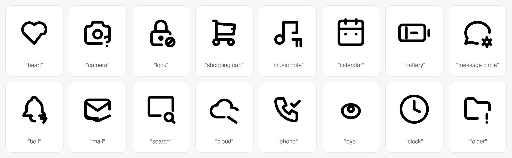
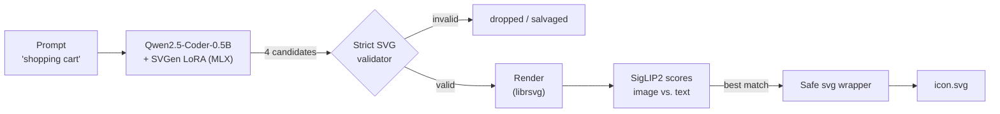
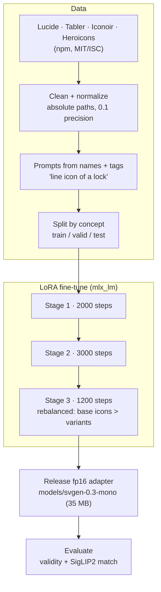
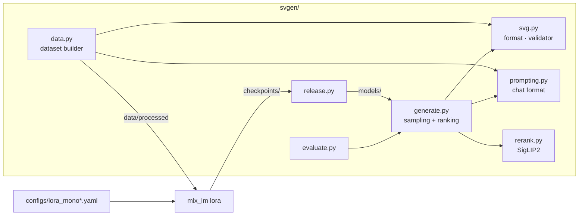

<div align="center">

# SVGen

**Text in, clean SVG icon out.**

[](https://github.com/artamrj/SVGen/actions/workflows/tests.yml)
[](LICENSE)


A small language model fine-tuned to draw black-and-white line icons as real, editable SVG code. Trained and run on a MacBook.



</div>

```bash
make svg PROMPT="shopping cart" OUT=cart.svg
```

```xml
<svg xmlns="http://www.w3.org/2000/svg" viewBox="0 0 24 24" fill="none" stroke="currentColor" stroke-width="2" stroke-linecap="round" stroke-linejoin="round">
  <path d="M4 19A2 2 0 1 0 8 19A2 2 0 1 0 4 19"/><path d="M15 19A2 2 0 1 0 19 19A2 2 0 1 0 15 19"/>
  <path d="M17 17H6V3H4"/><path d="M6 5L20 6L19 13H6"/>
</svg>
```

## How it works



The model writes **only shapes** (`path`, `circle`, `rect`, `line`, `ellipse`). SVGen adds the `<svg>` wrapper, so every output is well-formed, safe (no scripts or external links), and recolorable with CSS `color`.

## Training



| | |
|---|---|
| **Base model** | Qwen2.5-Coder-0.5B-Instruct |
| **Method** | LoRA, rank 32, all layers (17.6M trainable params) |
| **Data** | 8,873 unique 24×24 line icons, ~24k prompt–SVG pairs |
| **Hardware** | MacBook Pro M1 Pro, 16 GB, Apple MLX |
| **Training time** | ~5 h at low priority, laptop stayed usable |

## Results

Measured on held-out concepts the model never saw in training:

| Metric | Score |
|---|---|
| Valid SVG samples | **98.8%** |
| Prompts with a usable icon | **100%** |
| SigLIP2 text match | **0.165** (real icons: 0.184) |

Common UI concepts work well. Icons that are one long precise shape (star, rocket, bicycle) and unusual prompts are still weak. Full details are in the [model card](docs/model_card_svgen_0.3.md).

## Quickstart

Requires an Apple Silicon Mac.

```bash
make setup               # create venv, install dependencies
brew install librsvg     # rendering for reranking
make svg PROMPT="lock" OUT=lock.svg
```

```python
from svgen.generate import text_to_svg
svg = text_to_svg("cloud", n=4)
```

Train from scratch on a Mac: `make data-download data train release eval`.

Train the larger 1.5B model on a free Colab GPU:

[](https://colab.research.google.com/github/artamrj/SVGen/blob/main/notebooks/train_colab.ipynb)

## Project structure



## Roadmap

- [x] Black-and-white line icons on a laptop (v0.3)
- [ ] Larger base model (1.5B) trained on a cloud GPU
- [ ] Visual captions from a vision model, instead of names and tags
- [ ] Reinforcement learning from rendered output (GRPO + SigLIP2 reward)
- [ ] Filled icons, then color
- [ ] Rust runtime inference (the safety validator already exists in `runtime/`)

## License

Code: [MIT](LICENSE). The model adapter builds on Qwen2.5-Coder (Apache-2.0), and training icons keep their own licenses (below).

## Credits

Icons for training: [Lucide](https://lucide.dev) (ISC), [Tabler Icons](https://tabler.io/icons), [Iconoir](https://iconoir.com), and [Heroicons](https://heroicons.com) (MIT). Base model: [Qwen2.5-Coder](https://huggingface.co/Qwen/Qwen2.5-Coder-0.5B-Instruct).
