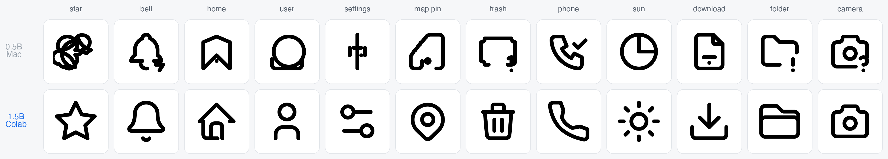
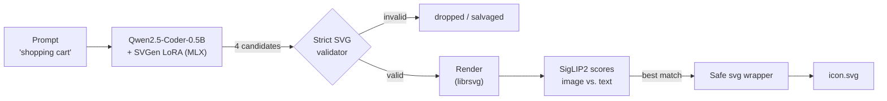
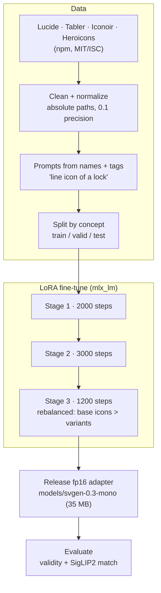
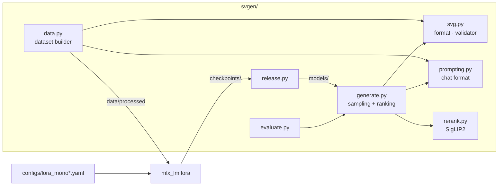

<div align="center">

# SVGen

**Text in, clean SVG icon out.**

[](https://github.com/artamrj/SVGen/actions/workflows/tests.yml)
[](LICENSE)


A small language model fine-tuned to draw black-and-white line icons as real, editable SVG code. Runs locally on a MacBook.



*Same prompts, two models: v0.3 (0.5B, trained on a MacBook) above, v0.4 (1.5B, trained on Colab) below.*

</div>

```bash
make svg PROMPT="shopping cart" OUT=cart.svg
```

```xml
<svg xmlns="http://www.w3.org/2000/svg" viewBox="0 0 24 24" fill="none" stroke="currentColor" stroke-width="2" stroke-linecap="round" stroke-linejoin="round">
  <path d="M4 19A2 2 0 1 0 8 19A2 2 0 1 0 4 19"/><path d="M15 19A2 2 0 1 0 19 19A2 2 0 1 0 15 19"/>
  <path d="M17 17H6V3H4"/><path d="M6 5L20 6L19 13H6"/>
</svg>
```

## How it works



The model writes **only shapes** (`path`, `circle`, `rect`, `line`, `ellipse`). SVGen adds the `<svg>` wrapper, so every output is well-formed, safe (no scripts or external links), and recolorable with CSS `color`.

## Two versions

| | **v0.3 Mono** | **v0.4 Colab** (current) |
|---|---|---|
| Base model | Qwen2.5-Coder-0.5B | Qwen2.5-Coder-1.5B |
| Trained on | MacBook Pro M1 Pro, MLX, ~5 h | Google Colab GPU, PyTorch, ~4.5 h |
| Size on disk | 35 MB adapter (in this repo) | 141 MB adapter ([v0.4 release](https://github.com/artamrj/SVGen/releases/tag/v0.4)) → 1.5 GB 8-bit model via `make build-1.5b` |
| SigLIP2 match, unseen icons | 0.165 | **0.180** (real icons: 0.184) |
| SigLIP2 match, free prompts | 0.146 | **0.185** |
| Valid SVG samples | 98.8% | 98.8% |

Both stay in the repo: v0.3 is the default because it is tiny and committed; v0.4 is the better model.

```bash
make svg PROMPT="star" BASE=models/svgen-1.5b ADAPTER=none OUT=star.svg   # v0.4
```

## Training



Same data and recipe for both versions: LoRA rank 32 on all layers, loss only on the SVG answer, 8,873 unique 24×24 line icons (~24k prompt–SVG pairs) split by concept so test icons are never seen in training.

| | v0.3 | v0.4 |
|---|---|---|
| Trainer | `mlx_lm lora`, 3 stages, 6,200 steps | `svgen.train_cuda` (PyTorch + PEFT), 4,485 steps |
| Hardware | M1 Pro 16 GB, laptop stayed usable | Colab GPU (fp16) |
| Best val loss | 0.384 | 0.393 at step 2000, then overfit to 0.451 |

The v0.4 run kept training after its best point and started memorizing. The trainer now saves the best checkpoint and stops early, so the next run should land higher still.

## Results

On 40 held-out concepts plus 20 free prompts, 4 samples each, best pick by SigLIP2:

| Metric | v0.3 | v0.4 |
|---|---|---|
| Valid SVG samples | 98.8% | 98.8% |
| Prompts with a usable icon | 100% | 100% |
| SigLIP2 match, unseen icons | 0.165 | **0.180** (real icons: 0.184) |
| SigLIP2 match, free prompts | 0.146 | **0.185** |

v0.3 draws common UI concepts well but fails on long precise shapes (star, rocket, bicycle). v0.4 gets those right and is nearly on par with hand-drawn icons on unseen concepts. Model cards: [v0.3](docs/model_card_svgen_0.3.md) · [v0.4](docs/model_card_svgen_0.4.md).

## Quickstart

Requires an Apple Silicon Mac.

```bash
make setup               # create venv, install dependencies
brew install librsvg     # rendering for reranking
make svg PROMPT="lock" OUT=lock.svg
```

```python
from svgen.generate import text_to_svg
svg = text_to_svg("cloud", n=4)
```

Train from scratch on a Mac: `make data-download data train release eval`.

Train the larger 1.5B model on a free Colab GPU:

[](https://colab.research.google.com/github/artamrj/SVGen/blob/main/notebooks/train_colab.ipynb)

## Project structure



## Roadmap

Today SVGen draws what it has seen, and combines parts of it. The goal is to draw *anything* you describe.

- [x] Black-and-white line icons, trained on a laptop (v0.3)
- [x] Larger base model (1.5B) on a cloud GPU, v0.4 ([#1](https://github.com/artamrj/SVGen/issues/1))

**Toward drawing anything**

- [ ] **More, more varied data:** SVG-1M, SVGX and filled sets with animals, objects and scenes ([#2](https://github.com/artamrj/SVGen/issues/2))
- [ ] **Part-by-part captions:** a vision model writes "round head, two triangle ears", so the model learns description → shapes ([#3](https://github.com/artamrj/SVGen/issues/3))
- [ ] **Think, then draw:** plan the shapes first, then write the SVG, like Reason-SVG ([#4](https://github.com/artamrj/SVGen/issues/4))
- [ ] **Learn from the rendered result:** RL (GRPO) with a SigLIP2 "does it look like the prompt?" reward ([#5](https://github.com/artamrj/SVGen/issues/5))

**Later**

- [ ] Filled icons, then color
- [ ] Rust runtime inference (the safety validator already exists in `runtime/`)

## License

Code: [MIT](LICENSE). The model adapter builds on Qwen2.5-Coder (Apache-2.0), and training icons keep their own licenses (below).

## Credits

Icons for training: [Lucide](https://lucide.dev) (ISC), [Tabler Icons](https://tabler.io/icons), [Iconoir](https://iconoir.com), and [Heroicons](https://heroicons.com) (MIT). Base model: [Qwen2.5-Coder](https://huggingface.co/Qwen/Qwen2.5-Coder-0.5B-Instruct).
