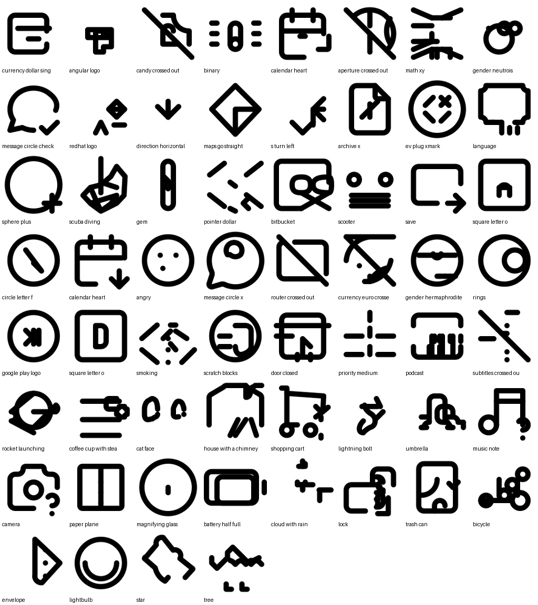

# SVGen

Text in, clean black-and-white SVG icon out.

```bash
make svg PROMPT="camera" OUT=reports/camera.svg
```

SVGen 0.3 Mono is a small language model fine-tuned to draw 24×24 line icons as SVG code. It runs locally on an Apple Silicon Mac. The model lives in this repository: a 35 MB LoRA adapter on top of `Qwen2.5-Coder-0.5B-Instruct`.



## How it works

```text
prompt ──► Qwen2.5-Coder-0.5B + SVGen LoRA (MLX)
              │  samples N candidates in one batch
              ▼
         strict SVG parser ──► drop invalid output, keep complete shapes
              ▼
         render (librsvg) ──► SigLIP2 picks the candidate that best matches the prompt
              ▼
         safe <svg> wrapper ──► file
```

* **The model writes only shapes**: `path`, `circle`, `rect`, `line` and `ellipse`, in absolute coordinates rounded to 0.1. SVGen adds the `<svg>` wrapper itself (24×24 canvas, `stroke="currentColor"`, round caps). The output is always well-formed, safe, and themable with CSS `color`.
* **Best-of-N + reranking**: sampling 4 candidates and keeping the one whose rendering best matches the text (SigLIP2) is a cheap, large quality boost. Pass `--no-clip` to skip it.
* **Safety**: anything outside the allowed shapes and attributes is rejected: no scripts, no external references, no coordinates off the canvas.

## Quickstart (Apple Silicon)

```bash
make setup                                   # venv + dependencies
brew install librsvg                         # rendering, used for reranking
make svg PROMPT="lock" OUT=reports/lock.svg
```

From Python:

```python
from svgen.generate import text_to_svg
svg = text_to_svg("cloud with rain", n=4)
```

Command-line options: `python -m svgen.generate --help` (`-n` candidates, `--temperature`, `--stroke-width`, `--seed`, `--no-clip`).

## Train it yourself

```bash
make data-download   # Lucide, Tabler, Iconoir, Heroicons from npm (~10 MB)
make data            # clean ~8.9k icons into data/processed/{train,valid,test}.jsonl
make train           # 3-stage LoRA fine-tune with mlx_lm, runs at low priority
make release         # half-precision adapter into models/svgen-0.3-mono
make eval            # held-out concepts + free prompts -> reports/eval.json, eval_sheet.png
```

Training takes about 4–5 hours on an M1 Pro (16 GB) while the laptop stays usable. Run only one GPU job at a time: macOS kills GPU work that hurts screen responsiveness.

## Layout

```text
svgen/        0.3 pipeline: svg format, dataset, generation, reranking, evaluation, release
configs/      lora_mono*.yaml training stages
models/       released LoRA adapter (committed)
tests/        pytest suite
docs/         model cards and dataset notes
runtime/      Rust CLI with the SVG safety validator (inference not ported yet)
training/     legacy 0.2 tiny PyTorch model (make legacy-*)
```

## Status and limits

See [docs/model_card_svgen_0.3.md](docs/model_card_svgen_0.3.md) for numbers. In short:

* Style and validity are solid: almost every sample is a valid, clean line icon.
* Concepts the icon packs cover well (lock, camera, heart, arrows, devices, UI symbols) come out recognizable. Unusual or compositional prompts ("cat riding a bicycle") often don't.
* Black and white line icons only, by design. Filled icons and color come next.

## Roadmap

1. Bigger base (Qwen2.5-Coder-1.5B, already supported by the config) on a GPU machine.
2. Richer captions: describe each rendered icon with a vision model instead of using names and tags.
3. RL from rendering feedback (GRPO with a SigLIP reward), the step behind recent SVG models such as RLRF and Reason-SVG.
4. Filled icons, then color.
