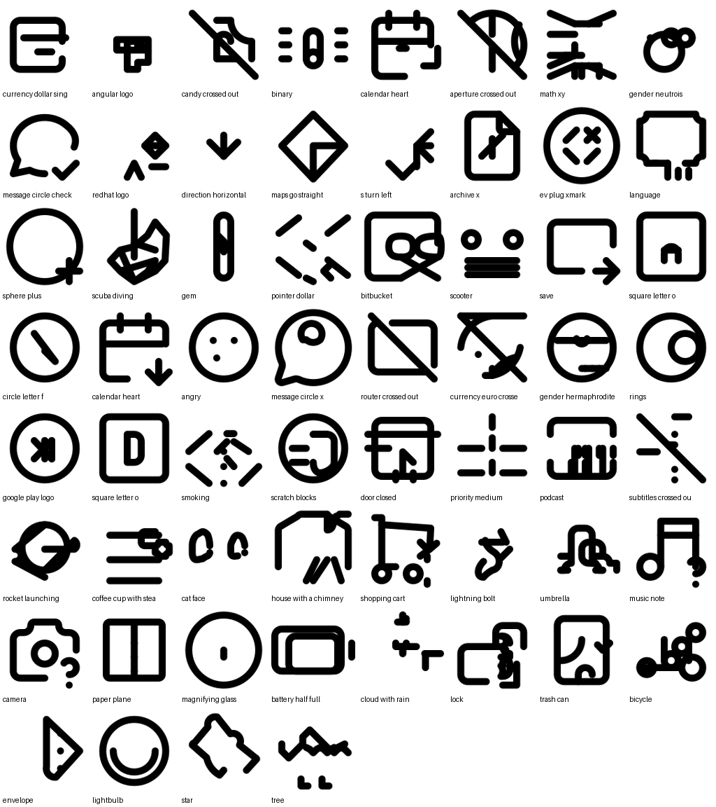

# Model Card: SVGen 0.3 Mono

Text-to-SVG generator for black-and-white 24×24 line icons.

| | |
|---|---|
| Base model | `Qwen2.5-Coder-0.5B-Instruct` (MLX bf16) |
| Method | LoRA, rank 32, scale 2, all 24 blocks (17.6M trainable params, 3.6%) |
| Weights | `models/svgen-0.3-mono/adapters.safetensors` (fp16, 35 MB) |
| Framework | `mlx_lm` 0.32 on Apple Silicon (M1 Pro, 16 GB) |
| Output | shapes only (`path`, `circle`, `rect`, `line`, `ellipse`), wrapped by SVGen into a safe `<svg>` |

## Data

8,873 unique icons after cleaning and de-duplication:

| Source | License | Icons |
|---|---|---|
| Lucide | ISC | 1,997 |
| Tabler (outline) | MIT | 5,187 |
| Iconoir (regular) | MIT | 1,369 |
| Heroicons (24 outline) | MIT | 320 |

* **Cleaning:** every icon is converted to one canonical format: absolute path commands, numbers rounded to 0.1 (rounding absolute coordinates avoids drift on long relative paths), polylines turned into paths, styling and invisible helper shapes removed. A render check on 300 random icons gave 0.27% mean pixel difference from the originals.
* **Prompts:** built from icon names and tags with varied templates, e.g. "camera icon", "line icon of a lock", "heart (love, like)".
* **Split by concept:** 150 concept groups for test and 120 for validation. "arrow-down" and "arrow-down-2" always land in the same split, so test concepts are never seen in training.
* **Rebalancing (stage 3):** Tabler has dozens of variants per concept (heart-bolt, heart-question, …). Base icons get 5 prompts and variants get 1, so "heart" draws a heart instead of a variant.

## Training

| Stage | Data | Steps × batch | LR (cosine) | Final val loss |
|---|---|---|---|---|
| 1 | plain, 17.1k rows | 2000 × 8 | 2e-4 → 1e-5 | 0.461 |
| 2 | plain, resumed | 3000 × 8 | 1.5e-4 → 5e-6 | 0.384 |
| 3 | rebalanced, 24k rows | 1200 × 8 | 8e-5 → 5e-6 | 0.398 * |

\* Stage 3 validation uses the same held-out icons, but the training data changed, so this loss is not directly comparable to stage 2.

Loss is only computed on the SVG answer (`mask_prompt`). Training ran at about 350–550 tokens/sec at low priority (`nice`), roughly 5 hours in total.

## Evaluation

`python -m svgen.evaluate --limit 40 -n 4`: 40 held-out concepts plus 20 free prompts, 4 samples each, best pick chosen by SigLIP2.

| Metric | Stage 1 | **0.3 final** |
|---|---|---|
| Raw samples that are valid SVG | 97.1% | **98.8%** |
| Prompts with a usable icon | 100% | **100%** |
| SigLIP2 match, held-out concepts | 0.154 | **0.165** |
| SigLIP2 match, free prompts | 0.130 | **0.146** |
| SigLIP2 match of the *real* held-out icons (reference) | 0.184 | 0.184 |

SigLIP2 ViT-B/16 was chosen as the judge because it matched held-out icons to their names 88% of the time, against 71% for CLIP ViT-B/32. MobileCLIP2 failed to load correctly through open_clip.

Curated good outputs: [showcase.png](showcase.png) · example files in [examples/](examples/)

## What works and what does not

* **Works:** valid, clean, consistent line-icon style. Common UI concepts made of simple geometry (camera, heart, lock, calendar, chat bubble, shopping cart, battery, music note, crossed-out variants).
* **Weak:** icons that are one long precise path (star, rocket, bicycle, umbrella), unusual concepts, and compositions of several objects. A 0.5B model with a LoRA adapter can't store enough exact coordinates for these.
* **Out of scope:** filled icons, color, illustrations.

## Next steps (in order of expected gain)

1. Train the same recipe on `Qwen2.5-Coder-1.5B` for 4–5 epochs on a cloud GPU. Val loss had flattened on the 0.5B model, which points to capacity as the limit.
2. Generate visual captions for each rendered icon with a vision model, instead of relying on names and tags.
3. GRPO with a rendering reward (SigLIP2 match + validity + compactness).
4. Add filled icons (Material Symbols, Phosphor), then color.
