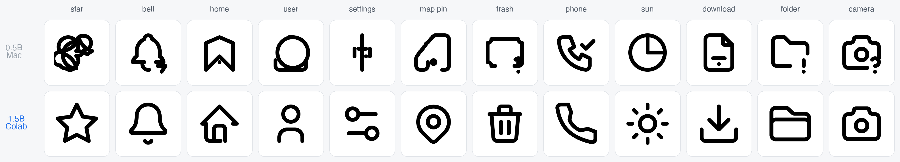

# Model Card: SVGen 0.4 Colab

Second test version. Same recipe and data as [0.3](model_card_svgen_0.3.md), three times the model, trained on a cloud GPU.

| | |
|---|---|
| Base model | `Qwen2.5-Coder-1.5B-Instruct` |
| Method | LoRA, rank 32, alpha 64, all attention and MLP projections (36.9M trainable params, 2.3%) |
| Trainer | `svgen.train_cuda` (PyTorch + PEFT), fp16 autocast, effective batch 16 |
| Schedule | 4,485 steps (3 epochs), cosine 2e-4 → 1e-5, warmup 100 |
| Hardware | Google Colab GPU, ~930 tokens/s, ~4.5 h |
| Data | identical to 0.3: 23,915 rows after dropping those over 768 tokens |

## Training curve

| Step | Train loss | Val loss (unseen icons) |
|---|---|---|
| 400 | 0.51 | 0.511 |
| 1200 | 0.35 | 0.421 |
| **2000** | 0.19 | **0.393** |
| 2800 | 0.12 | 0.401 |
| 3600 | 0.06 | 0.444 |
| 4485 (final) | 0.04 | 0.451 |

The model peaked at ~1.3 epochs and then memorized the training set. This release is the **final** weights, because the first trainer kept only the last checkpoint. The trainer now saves the best checkpoint and stops early (`--patience`), so a rerun should keep the step-2000 model.

## Evaluation

`python -m svgen.evaluate --base models/svgen-1.5b --adapter none --limit 40 -n 4`, same held-out icons and free prompts as 0.3.

| Metric | 0.3 (0.5B) | **0.4 (1.5B)** |
|---|---|---|
| Valid SVG samples | 98.8% | 98.8% |
| Prompts with a usable icon | 100% | 100% |
| SigLIP2 match, held-out concepts | 0.165 | **0.180** |
| SigLIP2 match, free prompts | 0.146 | **0.185** |
| Real held-out icons (reference) | 0.184 | 0.184 |



All 60 evaluation outputs: [samples_1.5b.png](samples_1.5b.png) · raw scores: [eval_1.5b.json](eval_1.5b.json) · example files: [examples_1.5b/](examples_1.5b/)

## What changed in practice

* Long single-path icons that 0.3 could not draw now work: star, umbrella, bicycle, trash can, lightbulb, magnifying glass, paper plane.
* Free prompts score higher than the held-out set, meaning common concepts are drawn about as well as hand-made icons.
* Still weak: compositions of several objects ("coffee cup with steam" is fine, "cat face" is not) and concepts absent from UI icon packs (tree). Despite memorizing the training set, generalization held up.

## Download

The PEFT adapter weights (141 MB) are attached to the [v0.4 release](https://github.com/artamrj/SVGen/releases/tag/v0.4); `make build-1.5b` downloads them, merges into the base model and converts to an 8-bit MLX model (1.5 GB):

```bash
make build-1.5b
make svg PROMPT="rocket" BASE=models/svgen-1.5b ADAPTER=none OUT=rocket.svg
```

Training log: [train_log_0.4.jsonl](train_log_0.4.jsonl).
